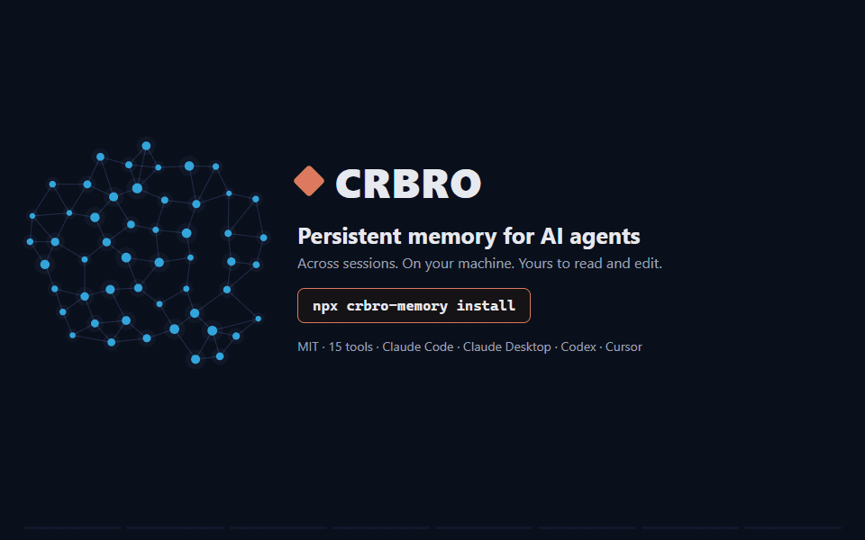

# 🧠 CRBRO — Persistent Neural Memory for AI

[](https://www.npmjs.com/package/crbro-memory)
[](https://github.com/Octonove/crbro-memory/blob/master/LICENSE)
[](https://modelcontextprotocol.io)
[](https://github.com/Octonove/crbro-memory)
[](https://glama.ai/mcp/servers/Octonove/crbro-memory)
[](https://mcpservers.org/servers/octonove/crbro-memory)

**CRBRO** is a local MCP (Model Context Protocol) server that gives your AI assistant **persistent long-term memory** across sessions. It uses a biological neural architecture — cortex, synapses, hippocampus — to store, connect, and retrieve knowledge automatically. Everything lives in plain JSON files on your machine.



Free and open source (MIT). All 15 tools included — no license, no account, no tiers.

**This page has three layers.** [1. Quick start](#1-quick-start) gets you running in a minute. [2. Reference](#2-reference) lists the tools, the commands and the environment variables. [3. Measurements](#3-measurements) says what it costs and how well it works, with dates. [Troubleshooting](#troubleshooting-and-faq) covers the problems people actually hit.

---

## 1. Quick start

You need **Node.js 20 or later** (the Claude Desktop bundle below needs none).

### Claude Desktop: one double click

Download the `.mcpb` bundle from the [latest release](https://github.com/Octonove/crbro-memory/releases/latest) and double-click it with Claude Desktop open. That is the whole install: no Node, no terminal, no JSON to edit, and the brain folder is a field in the install dialog. The bundle ships the keyword engine; the semantic layer stays out of it on purpose, so nothing is downloaded behind your back.

### Every other client: one command

```bash
npx crbro-memory install
```

It finds the MCP clients on this machine (Claude Code, Claude Desktop, Cursor, Codex), copies the engine to one stable folder (`~/.crbro-engine/<version>`, or `--engine-dir DIR`), registers `node <that folder>/crbro.mjs` in each client with the timeouts that client needs, and makes the memory load itself at the start of every conversation. No `npx` at client start, so every client runs the same build and shares one daemon. It merges into your config files and never rewrites them: every file it touches keeps a timestamped backup beside it (`<file>.crbro-bak-<stamp>`). Pick clients with `--clients claude-code,codex` (default `auto`), see what it would do first with `--dry-run`, and get the report as JSON with `--json`. `npx crbro-memory uninstall` takes the same flags and removes only what CRBRO added — never the brain ([complete uninstall](#complete-uninstall)).

Then **restart the client, open a new conversation, and check that `crbro_boot` actually ran** and returned a neuron count. `npx crbro-memory doctor` is a read-only check of what is installed where.

> **Installing the server does not call it.** The tools are there, the brain is on disk, and nothing reads it: the assistant answers from nothing and the memory looks broken when it is merely asleep. Every "CRBRO doesn't remember" report so far has been this, not a bug in recall. The `install` command above wires the start for you; the manual route is below.

### Registering by hand

Prefer to edit config yourself? Register CRBRO at the **user level, not per-project**: the brain lives in `~/.crbro/` and is shared across every folder, but a server registered inside one project is missing everywhere else and it will *look* like the memory is gone.

**Claude Code** (one command, available in every folder):
```bash
claude mcp add --scope user crbro -- npx -y crbro-memory
```

**Claude Desktop** — `%APPDATA%\Claude\claude_desktop_config.json` on Windows, `~/Library/Application Support/Claude/claude_desktop_config.json` on macOS, `~/.config/Claude/claude_desktop_config.json` on Linux:
```json
{
  "mcpServers": {
    "crbro": {
      "command": "npx",
      "args": ["-y", "crbro-memory"]
    }
  }
}
```

**Cursor** — `~/.cursor/mcp.json` (the one in your home folder, not a project's `.cursor/`): same JSON as above.

**Codex** — `~/.codex/config.toml`. Give it a startup timeout: Codex starts MCP servers when a session opens and gives up after a short default (see [Troubleshooting](#codex-says-the-mcp-server-timed-out-at-startup)).
```toml
[mcp_servers.crbro]
command = "npx"
args = ["-y", "crbro-memory"]
startup_timeout_sec = 60
tool_timeout_sec = 120
```
`install` and `install-boot` add these two lines only when they are missing; values you set yourself are kept.

**Docker** (the brain lives in `/root/.crbro`; mount a volume to keep it. The image carries no semantic runtime, so recall is keyword-only there):
```bash
docker build -t crbro-memory . && docker run -i -v crbro-brain:/root/.crbro crbro-memory
```

### Making it load itself, by hand

```bash
npx crbro-memory install-boot
```

`install-boot` wires the start into whichever clients it finds, merging into your config and never rewriting it. It is idempotent, and it leaves alone any hook you already wrote yourself:

| Client | What it writes |
|---|---|
| **Claude Code** | `SessionStart` in `~/.claude/settings.json` — a command whose stdout enters the session telling the model to call `crbro_boot` first. Claude Code cannot invoke an MCP tool from a hook, so the instruction *is* the mechanism. |
| **Codex** | `SessionStart` in `~/.codex/hooks.json` — an `mcp_tool` step that calls `crbro_boot` directly, **plus** the same printed instruction as a second layer. The hook can fire before the MCP server has finished starting, and then the direct call is simply lost; the instruction covers that window. |

**Tools without session hooks** (Cursor, Windsurf, Antigravity…) do the same job from their always-on rules file — `.cursorrules`, `.windsurfrules`, User Rules. `install-boot` prints the exact line to paste:

> CRBRO: call `mcp__crbro__crbro_boot` as your FIRST tool action, before answering, unless this session already contains its result. Apply the `protocol_enforcement` block it returns for the rest of the session.

### Semantic recall (optional)

`npx crbro-memory init` creates the brain and installs a local embedding model that is fused with the keyword engine, so paraphrases the words do not cover start to land. It is a download of several hundred MB once per machine (sizes and timings in [Measurements](#3-measurements)); `init --no-semantic` skips it and `CRBRO_SEMANTIC=0` turns it off any time. Details: [docs/semantic-recall.md](docs/semantic-recall.md).

### Using it

Your AI now has 15 memory tools and boots the brain on its own. `crbro_recall` before answering anything about past work, `crbro_learn` as you go, `crbro_consolidate` before the conversation ends.

More that you can switch on, each in [docs/hooks.md](docs/hooks.md) and [docs/daemon.md](docs/daemon.md): the guard hook (stored lessons speak before a shell command runs), the compaction checkpoint, the subagent hook, the open-items band in Claude Code, and the daemon for several clients on one brain.

---

## 2. Reference

### The 15 tools

| Tool | Description |
|------|-------------|
| `crbro_boot` | Boot the brain at session start — loads hot topics, context, the last three sessions and the `retired_tools` map. `project` (the folder or repo name) puts that project's neurons first and lists them in `project_neurons` |
| `crbro_inspect` | Read-only views by id or name: `view=status` (with the version the process runs, and the one installed on disk when npx replaced it under a running process), `neuron`, `neurons`, `sessions`, `global_map`. `view=neuron` is an index by default — every entry as id, kind, date and preview; `entries=[ids]` reads those in full, `detail=full` the whole neuron. `view=sessions session=<id>` reads one day log whole |
| `crbro_learn` | Store a fact, decision, pattern, preference, error or debt with search keywords. `supersedes` replaces old facts; `shelf_life`, `reference` and `temporal` describe the claim. Repeating it never verifies it; use an explicit `crbro_revise status=verified` with evidence after a real check |
| `crbro_recall` | Search every stored line, not just topic names — returns what matched, how confidently, and the topic's next best lines. Several phrasings at once are fused by rank; `since` (`"2026-09-01"`, `"2w"`) and `kind` (`["error"]`) narrow it; `sessions_matched` lists the day logs that mention it. A line that is not yours says where it came from (`origin`). A row past its shelf life comes back apart, in `possibly_stale`, with what to check before answering |
| `crbro_revise` | Retire facts (and decisions, patterns, errors, debts via `entries`) as superseded or retracted, reactivate them with `status=active`, reconfirm checked ones with `status=verified`, edit summary, domain, tags or name, and split a neuron with `move_to` — the entries keep their dates |
| `crbro_forget` | Remove for good, keeping a copy in `.quarantine/` first — entries of a neuron, a whole neuron (two-step with `confirm_token`), a session log; `restore` and `merge_into` too |
| `crbro_connect` | Create, strengthen, set the strength of or delete (`action=disconnect`) a connection between neurons |
| `crbro_context` | Read (no arguments) or update the active working context — topics, open items, discard or clear |
| `crbro_map` | Keep one living map of how a topic's system works — replaced whole, never patched |
| `crbro_consolidate` | End-of-session consolidation — the only way to log a session; links the topics it wrote and syncs spaces. `promotion_candidates`: lessons this session's projects share with other projects — suggested, never moved |
| `crbro_maintenance` | Brain maintenance — heat, pruning, integrity, `repair`, `unarchive`, index rebuild. Every run reports expired entries, entries past their shelf life, oversized neurons and bulk-import leftovers; `backfill_dates` and `compact` act on them |
| `crbro_audit` | Find credentials stored in the brain, session logs included — reports the kind, never the value |
| `crbro_secret` | Put a credential in the OS keychain and keep only its name in the brain. See [docs/credentials.md](docs/credentials.md) |
| `crbro_space` | Create, join, `sync` or `leave` a team space — a private git repo for shared projects. See [docs/team-memory.md](docs/team-memory.md) |
| `crbro_share` | Put one project into a space, after showing exactly what would be sent; `unshare` stops following it |

A 1.x brain opens as it is: see [Upgrading from 1.x](docs/upgrading-from-1x.md) for the retired tool names.

### Commands

Every command is run as `npx crbro-memory <command>` (there is no separate `crbro` binary). `--version` prints the version and `<command> --help` explains one command.

**Setup and checks**

| Command | What it does |
|---|---|
| `install` / `uninstall` | Register CRBRO in your MCP clients and wire the boot hook; remove what it installed. `--dry-run` lists the changes without making them |
| `init` | Create the brain and install semantic recall (`--no-semantic` skips it) |
| `install-boot` | Make the memory load itself in every conversation (above) |
| `status` | Show the brain's status |
| `doctor [--json]` | Read-only diagnostics: versions, brain and client paths, hooks, daemon leftovers, quarantine, backups' age, semantic files. Repairs nothing, reads no credential values. See [docs/doctor.md](docs/doctor.md) |
| `reindex` | Rebuild the search index |
| `eval` | Measure retrieval quality against your own query set ([docs/semantic-recall.md](docs/semantic-recall.md#measuring-retrieval)) |

**Viewing, moving and serving the memory**

| Command | What it does |
|---|---|
| `view [--port N] [--no-open]` | A local page in your browser (127.0.0.1 only, one-time token in the link): neurons, every entry with its date, status, verification and freshness, search, open items to resolve or discard, stale entries to verify or retire |
| `export [--out DIR] [--format md\|json] [--include-retired]` | Write the brain as an Obsidian-compatible Markdown vault or one JSON file. Read-only, safe while a client runs, credentials redacted |
| `import PATH [--apply] [--topic NAME] [--type fact\|preference\|pattern]` | Bring memory in from `CLAUDE.md` / `AGENTS.md`, a Claude Code memory folder or a CRBRO export. A dry run unless `--apply`; importing twice adds nothing |
| `serve --http [--port 8787] [--host 127.0.0.1] [--allow-remote] [--new-token] [--allow-secrets]` | MCP over Streamable HTTP at `/mcp` with a bearer token (`CRBRO_HTTP_TOKEN` or the keychain). Loopback unless `--allow-remote`; no TLS, no OAuth; `crbro_secret` is left out unless `--allow-secrets`. Some antivirus web shields (Avast's, for one) rewrite MCP traffic on loopback: exclude the port if requests fail |

**Credentials, backups, daemon**

| Command | What it does |
|---|---|
| `secret set\|get\|list\|remove\|status` | Credentials in the OS keychain; the value is read from stdin, never argv ([docs/credentials.md](docs/credentials.md)) |
| `backup`, `backup list`, `backup restore FILE` | One gzipped copy of the brain, rotated; restore never lands on the live brain. `backup --keep N` sets how many to keep |
| `daemon on\|off\|status\|stop` | One process owns the brain for every client ([docs/daemon.md](docs/daemon.md)) |

**Claude Code hooks and mod**

| Command | What it does |
|---|---|
| `install-hooks --guard` | Stored lessons speak before a shell command runs. `guard "<command>"` shows what it would say |
| `install-hooks --compact` / `uninstall-hooks --compact` | Checkpoint before a compaction, picked back up after it |
| `install-hooks --inject` | Hand your protocols to spawned subagents (opt-in) |
| `install-hooks --verify` | SHA-256 of the installed hooks and mod against this package; changes nothing |
| `install-mod [--lang en\|es\|auto]` / `uninstall-mod` | The open-items band and `/pending` in Claude Code |

All of these are described in [docs/hooks.md](docs/hooks.md).

**Looking back, mining, semantic layer**

| Command | What it does |
|---|---|
| `usage [--days N] [--session ID] [--project DIR] [--json]` | Tokens per model and session from Claude Code's own logs, subagents apart. Read-only |
| `postmortem [--days N] [--max N] [--json]` | Candidate lessons from past sessions: corrections you repeated, a tool failing in a row. Stores nothing |
| `mine [dir]`, `setup-miner`, `miner-status`, `remove-miner` | Optional, fully local scan of your `.md`/`.txt` notes into the brain; "miner" means *knowledge* mining ([docs/architecture.md](docs/architecture.md)) |
| `semantic status\|install\|build` | The semantic layer's runtime, model and index ([docs/semantic-recall.md](docs/semantic-recall.md)) |

Unknown commands are rejected with a non-zero exit code instead of starting the server by accident.

### Environment variables

Set them in the `env` block of the MCP client's config to affect that client only, or in your shell. Flags (`0`/`1`) accept the values shown.

| Variable | Default | What it does |
|---|---|---|
| `CRBRO_PATH` | `~/.crbro` | Where the brain lives. Also read by the hooks and the CLI. `CRBRO_BRAIN_PATH` is an older alias still read by the guard and subagent hooks |
| `CRBRO_SEMANTIC` | on where the runtime is installed | `0` turns the semantic layer off: recall is the keyword engine alone |
| `CRBRO_SEMANTIC_HOME` | `~/.crbro/.semantic` | Where the semantic runtime and model are kept |
| `CRBRO_SEMANTIC_MODEL` | `Xenova/multilingual-e5-small` | Embedding model (any e5-family model) |
| `CRBRO_SEMANTIC_DTYPE` | `q8` | Model quantization |
| `CRBRO_SEMANTIC_FLOOR` | built in | Cosine floor under which a vector-only candidate is dropped |
| `CRBRO_SEMANTIC_BATCH` | built in | Lines embedded per batch |
| `CRBRO_SYNONYMS` | on | `0` turns off the bilingual synonym table |
| `CRBRO_RECENCY` | on | `0` turns off the small recency lift that breaks ties toward newer entries |
| `CRBRO_IDF` | on | `0` turns off weighting query terms by rarity |
| `CRBRO_STALENESS` | on | `0` switches off shelf-life tracking and `possibly_stale` |
| `CRBRO_SHELF_DAYS` | `volatile=90,normal=365,durable=730` | Override the shelf-life windows, e.g. `volatile=60,normal=300` |
| `CRBRO_AUTOBACKUP` | on | `0` disables the daily backup made at consolidation |
| `CRBRO_BACKUP_DIR` | `<brain parent>/<brain name>-backups/brain` (`~/.crbro-backups/brain`) | Where backups go; point it at a synced folder |
| `CRBRO_KEYS_DIR` | `~/.crbro-keys` | Where the keychain file lives on platforms that use one |
| `CRBRO_SECRET_<NAME>` | — | Environment fallback for `crbro_secret` on machines with no credential store |
| `CRBRO_DAEMON` | the brain's own flag | `1` / `0` forces daemon mode on or off for one client; see [docs/daemon.md](docs/daemon.md) |
| `CRBRO_DAEMON_IDLE_MIN` | `20` | Minutes without a conversation before a daemon exits; `0` keeps it running |
| `CRBRO_MOD` | on | `0` keeps this client from installing or updating the Claude Code mod |
| `CRBRO_LANG` | system locale | Language of the mod (`en` or `es`) when installed with `--lang auto` |
| `CRBRO_SUBAGENT_INJECT` | off | `full` makes the subagent hook inject the protocol block |
| `CRBRO_SUBAGENT_MATCHER` | — | Regex that scopes the subagent hook to some subagent types |
| `CRBRO_STARTUP_TRACE` | off | `1` traces the server's startup steps to stderr |
| `CRBRO_QUARANTINE_DAYS` | `180` | Days `.quarantine/` keeps what `crbro_forget` removed; `0` keeps it forever |
| `CLAUDE_CONFIG_DIR` | `~/.claude` | Where the hooks and the mod are installed, if you moved Claude Code's folder |
| `CODEX_HOME` | `~/.codex` | Same, for Codex |
| `CLAUDE_CODE_PLUGIN_DIRS` | — | Read and extended (never replaced) by the mod installer |
| `NODE_USE_SYSTEM_CA` | — | Node's own switch: trust the system certificate store (see [Troubleshooting](#npx-fails-with-unable_to_verify_leaf_signature)) |

<!-- TODO-INTEGRATOR: regenerate this table from `grep -rhoE "CRBRO_[A-Z0-9_]+" src bin hooks` after the merge: parcels A, C1, C2 and E add variables (CRBRO_STARTUP_TRACE and CRBRO_QUARANTINE_DAYS are from the plan; check their names and defaults, and add the opt-in switches for secrets-from-environment and for backup/quarantine encryption). -->

### More documentation

| | |
|---|---|
| [docs/features.md](docs/features.md) | The full feature list, version by version |
| [docs/hooks.md](docs/hooks.md) | Guard, compaction checkpoint, subagent hook, open-items mod |
| [docs/daemon.md](docs/daemon.md) | One process for every client |
| [docs/semantic-recall.md](docs/semantic-recall.md) | The embedding layer, and measuring retrieval on your own queries |
| [docs/credentials.md](docs/credentials.md) | The keychain and the `secret` command |
| [docs/team-memory.md](docs/team-memory.md) | Spaces: sharing projects through a git repo you own |
| [docs/architecture.md](docs/architecture.md) | What is on disk, the heat score, the miner |
| [docs/privacy.md](docs/privacy.md) | Exactly which data flows can touch the network |
| [docs/doctor.md](docs/doctor.md) | What `doctor` reports and what it never does |
| [docs/upgrading-from-1x.md](docs/upgrading-from-1x.md) | The 23 → 15 tools change |
| [docs/releasing.md](docs/releasing.md) | How releases are made (for maintainers) |
| [CONTRIBUTING.md](CONTRIBUTING.md), [SECURITY.md](SECURITY.md), [CHANGELOG.md](CHANGELOG.md) | |

---

## 3. Measurements

Every number about cost and quality comes from a script in [`benchmarks/`](https://github.com/Octonove/crbro-memory/tree/master/benchmarks) that you can run yourself. The unflattering results are published on purpose, and what the benchmarks deliberately do **not** claim — human productivity, "it knows you", comparisons against other memory systems — is in [`benchmarks/LIMITS.md`](https://github.com/Octonove/crbro-memory/blob/master/benchmarks/LIMITS.md).

**What runs in CI** on every push: the lexical retrieval benchmark (keyword engine alone, no model, no network) and the credential-redaction benchmark, both as gates that fail the build if they regress (`npm run bench`), plus the unit and integration test suite on Linux, Windows and macOS. Everything else below is run by hand, with the version and date next to it. The agentic benchmark puts a real Claude Code agent to work and spends tokens, so it is never run in CI.

<!-- MEASURE: version and date of the measurements below (integrator: fill in after the 2.11.0 run) -->

| What | Result | How to reproduce |
|---|---|---|
| **Cost: `tools/list`** (what an MCP client that loads every tool pays on each request) | <!-- MEASURE: characters and approximate tokens of the 15 tool definitions, with and without output schemas --> | `node benchmarks/cost/run.mjs` |
| **Cost: `crbro_boot`** (paid once per session) | <!-- MEASURE: characters of the boot response on a reference brain; say which brain --> | `node benchmarks/cost/run.mjs` |
| **Cost: `crbro_recall`** (per search, default five results) | <!-- MEASURE: characters per recall response --> | `node benchmarks/cost/run.mjs` |
| **Cost: `crbro_context`** | <!-- MEASURE: characters of a context read --> | `node benchmarks/cost/run.mjs` |
| **Retrieval, keyword engine alone** (blind paraphrased queries; the CI gate) | <!-- MEASURE: recall@1, recall@3, MRR, query count --> | `node benchmarks/retrieval/run.mjs` |
| **Retrieval, semantic layer on** | <!-- MEASURE: recall@1, recall@3 as installed, and inside the large haystack --> | `CRBRO_SEMANTIC=1 node benchmarks/retrieval/run.mjs` |
| **Retrieval, Spanish** (accents, hyphenated compounds, questions with no answer) | <!-- MEASURE: results of the Spanish benchmark gate --> | `node benchmarks/retrieval/run.mjs` (see its README) |
| **False confidence** (questions about things that are not stored) | <!-- MEASURE: distractors that reach a real hit's score, per mode --> | `node benchmarks/retrieval/run.mjs` |
| **Secret redaction** (adversarial credentials and near-miss innocents; the CI gate) | <!-- MEASURE: caught / false positives --> | `node benchmarks/security/run.mjs` |
| **Startup** (client connected until the first tool answers; with and without the daemon) | <!-- MEASURE: milliseconds, cold and warm --> | `node benchmarks/daemon/measure.mjs` |
| **Memory use** (RAM per client, with and without the daemon) | <!-- MEASURE: MB with three clients, daemon off / on --> | `node benchmarks/daemon/measure.mjs` |
| **Disk** (semantic layer: runtime and model) | <!-- MEASURE: MB on disk and time of the first install --> | `npx crbro-memory semantic status` |
| **First boot after upgrading** (the search index rebuilds once) | <!-- MEASURE: seconds on a reference brain; say how big --> | — |
| **Tests** | <!-- MEASURE: files and tests passed, skipped, on which OS --> | `npx vitest run` |
| **A fresh session does not ask again** (agentic; haiku and sonnet) | <!-- MEASURE: only if re-run for 2.11; otherwise leave the 2.7.2 result as historical --> | `node benchmarks/agentic/run.mjs` |

The figures published for 2.7.2 (retrieval, scale, false confidence, the agentic runs and the two stale-value experiments that did **not** meet their pre-registered claim) are kept, dated and with their caveats, in [docs/measurements-2.7.2.md](docs/measurements-2.7.2.md). They have not been re-measured for 2.11.

---

## Troubleshooting and FAQ

### CRBRO does not remember anything

Almost always the memory is asleep, not broken: the boot step is not wired, so the assistant never reads the brain. Run `npx crbro-memory doctor`, then `npx crbro-memory install-boot` (or `install`), restart the client and open a *new* conversation. Check that `crbro_boot` ran and returned a neuron count. If you have to call it by hand, the step did not take. If the server was registered inside one project instead of at the user level, other folders do not have the tools: register it with `--scope user`.

### Codex says the MCP server timed out at startup

Codex starts MCP servers when a session opens and waits only a short default time. A first start through `npx` also downloads the package. Give the server more time in `~/.codex/config.toml`:

```toml
[mcp_servers.crbro]
command = "npx"
args = ["-y", "crbro-memory"]
startup_timeout_sec = 60
tool_timeout_sec = 120
```

`npx crbro-memory install` writes these for you. The server answers `initialize` and `tools/list` at once, before it has loaded the brain, so a Codex that still times out is waiting on `npx` itself: install once with `npm install -g crbro-memory` and use `crbro-memory` as the command, or let `install` keep the engine in a stable folder. `CRBRO_STARTUP_TRACE=1` in the server's env prints where the time goes.

### Two daemons are running

Daemon mode is one process per *version* of CRBRO: after an upgrade, a client on the new version starts its own daemon and the old one exits by itself after 20 idle minutes (`CRBRO_DAEMON_IDLE_MIN`). Until then two are alive, and that is expected. `npx crbro-memory daemon status` lists them, `daemon stop` stops a daemon, and `doctor` flags leftovers of dead daemons. Never kill the process by hand while a client is mid-conversation; the client falls back to serving itself and carries on.

### The first start after upgrading is slow

2.11 reads words with accents (á, í, ú, ñ, ü) and hyphenated compounds differently, so the search index is rebuilt once the first time a brain is opened. How long depends on the size of the brain; it does not happen again. Do not interrupt it. The semantic layer, if installed, is not re-embedded.

### The keychain is missing or locked

`npx crbro-memory secret status` says which store this machine offers: Keychain on macOS (`security`), Secret Service on Linux (`secret-tool`, which needs a running D-Bus session), a DPAPI-sealed file on Windows. On a headless server, a CI runner or an SSH session with a locked keychain, `crbro_secret` says so in plain words instead of failing; use `CRBRO_SECRET_<NAME>` environment variables there. A missing keychain file is reported as missing, never treated as an empty keychain: if you moved or deleted `~/.crbro-keys`, restore it from your own backup before storing anything new. See [docs/credentials.md](docs/credentials.md).

### `npx` fails with `UNABLE_TO_VERIFY_LEAF_SIGNATURE`

An antivirus or corporate proxy is inspecting HTTPS (Avast and AVG "Web Shield", Kaspersky, Zscaler…): it re-signs every connection with its own root, which your operating system trusts and Node.js does not. Tell Node to trust the system store — it turns no check off: `setx NODE_USE_SYSTEM_CA 1` on Windows (then open a new terminal), `export NODE_USE_SYSTEM_CA=1` elsewhere; Node 22.15+. For one MCP client only, put it in that server's `env`. Never "fix" this with `strict-ssl=false` or `NODE_TLS_REJECT_UNAUTHORIZED=0`: those turn verification off for everything.

### Where does the memory live?

| What | Where |
|---|---|
| The brain (readable JSON) | `~/.crbro`, or `CRBRO_PATH`. Neurons in `cortex/`, connections in `synapses/`, session logs in `hippocampus/`, the search index in `.search/`. Layout: [docs/architecture.md](docs/architecture.md) |
| What `crbro_forget` removed | `<brain>/.quarantine/` until its retention runs out |
| Backups | `~/.crbro-backups/brain`, or `CRBRO_BACKUP_DIR` |
| The semantic runtime and model | `~/.crbro/.semantic`, or `CRBRO_SEMANTIC_HOME` |
| Credentials | The OS keychain (Windows: `~/.crbro-keys`, sealed with DPAPI). Never inside the brain, never in backups |
| Hooks and the mod | `~/.claude/settings.json`, `~/.claude/crbro-mods/`, `~/.codex/hooks.json` (and the `CLAUDE_CONFIG_DIR` / `CODEX_HOME` equivalents) |
| Team spaces | `<brain>/shared/<space>`, one git repo each |

### Complete uninstall

The one-command way, which lists everything first and removes only what CRBRO itself wrote:

```bash
npx crbro-memory uninstall --dry-run     # what it would remove
npx crbro-memory uninstall
```

It removes the registrations that run CRBRO in every client it finds, its hooks and boot wiring, the Claude Code mod and the engine folder `install` created. It keeps the backup of every file it edits, and it never touches the brain, your backups or the keychain: it prints where they are, and there is no flag that deletes them. That last step is yours (item 7 below).

By hand, or to check that nothing is left, in this order:

1. **Stop the daemon:** `npx crbro-memory daemon off`, then `daemon stop`.
2. **Unregister the server** from each client: `claude mcp remove crbro --scope user`; delete the `crbro` entry from Claude Desktop's `claude_desktop_config.json`, from `~/.cursor/mcp.json` and the `[mcp_servers.crbro]` table of `~/.codex/config.toml`. Uninstall the Claude Desktop extension from its settings if you used the `.mcpb`.
3. **Remove the hooks:** `npx crbro-memory uninstall-hooks --compact` and delete any remaining entry naming `crbro` from `~/.claude/settings.json` (`SessionStart`, `PreCompact`, `PreToolUse`, `SubagentStart`) and from `~/.codex/hooks.json`. `npx crbro-memory install-hooks --verify` shows what is still installed.
4. **Remove the Claude Code mod:** `npx crbro-memory uninstall-mod`.
5. **Remove the scheduled miner**, if you set it up: `npx crbro-memory remove-miner`.
6. **Remove credentials** you stored: `npx crbro-memory secret list`, then `secret remove NAME --yes` for each. Deleting the brain does *not* delete keychain entries.
7. **Delete the data**, only if you want the memory gone for good: `~/.crbro` (brain, quarantine and semantic model), `~/.crbro-backups`, `~/.crbro-keys`, and the engine folder that `install` created, if any (`uninstall --dry-run` names it).
8. Copies you shared with a team space stay on your teammates' disks and in the git remote.

### What does it send over the network?

Nothing to us, ever: there is no account, no telemetry. The optional semantic layer downloads a model once; team sync pushes only the projects you explicitly share, to a git remote you own; and what a tool returns is read by your AI client. [docs/privacy.md](docs/privacy.md) lists each flow.

---

## Contributing and support

Bug reports and pull requests are welcome: see [CONTRIBUTING.md](CONTRIBUTING.md). Report vulnerabilities as described in [SECURITY.md](https://github.com/Octonove/crbro-memory/blob/master/SECURITY.md).

> ⭐ **If CRBRO gives your AI a memory worth keeping, a [star on GitHub](https://github.com/Octonove/crbro-memory) is the best way to support it.**

<!-- invokard-coffee -->
**&#9749; If this saves you time, buy me a coffee.** [](https://www.paypal.com/donate/?business=stradoxx%40gmail.com&no_recurring=0&currency_code=EUR&item_name=Support%20crbro%20memory)

Or in USDC. Send **USDC only** and **only on the network shown**; on any other network it is lost with no way to recover it.

| Network | USDC address |
|---|---|
| **Solana** | `5n6Gfosk7SdwbvdtE9xiLWpcGPBBBGDZYRfAkWyCk86g` |
| **Ethereum** (ERC-20) | `0xe176866f9d7fdb498e0d4a983d3e34d84dcd6bfc` |

## License

MIT — see [LICENSE](https://github.com/Octonove/crbro-memory/blob/master/LICENSE). Built by [Octonove](https://github.com/Octonove).
