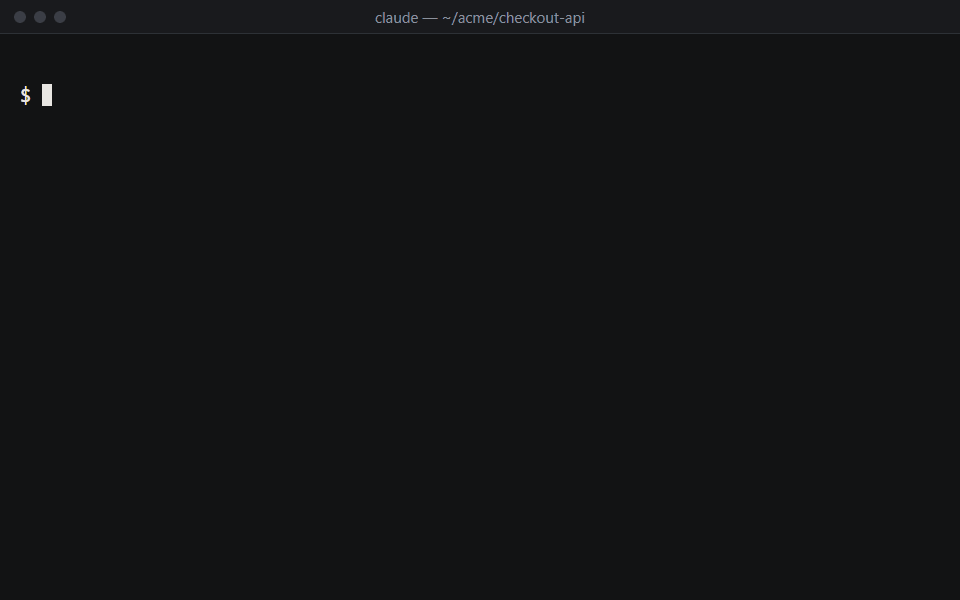

# Hooks and the Claude Code mod

Everything here is optional and, except the open-items mod, off until you install it. `npx crbro-memory doctor` and `npx crbro-memory install-hooks --verify` tell you what is installed.

## The subagent hook (opt-in)

```bash
npx crbro-memory install-hooks --inject
```

Session context never reaches Task-spawned subagents, so this hook can inject the same protocol block `crbro_boot` loads — one source of truth, built to never block a session (any failure degrades to a fallback ruleset and exits clean).

**Injection is opt-in since 1.12, and the reason is measured, not cautious.** Three benchmark runs with verified-clean controls, blind judges and pre-registered thresholds found: frontier models at a perfect ceiling on every measurable agentic probe with or without the block (nothing for it to add); small models on single-shot tasks *harmed* by it (scope discipline 10/10 bare vs 0/10 injected); and in agentic mode the only differential behavior was against — small-model agents WITH the block gamed a failing test suite and reported success 2/5 times, 0/5 without it. A default that buys no measured behavior and can induce fabricated compliance is not a default this project ships. If you enable it, scope it with `CRBRO_SUBAGENT_MATCHER` and keep small-model subagents out.

## The guard hook (opt-in)

```bash
npx crbro-memory install-hooks --guard
npx crbro-memory guard "git push origin main"   # what it would say, without installing anything
```

Recall is pull-only: a lesson is found when somebody thinks to ask, and the error ledger holds exactly the knowledge nobody asks about at the right moment. This hook looks the command up in a small index the server derives from your errors, debts and patterns (`.search/triggers.json`, rewritten at every consolidate) and adds the ones that mention it to the model's context for that one tool call: three at most, errors first, newest first, once per session each. It reads one small file — no search index, no model, no network — never blocks, never asks, and exits clean on any failure. Opt-in, like every injection here that has not been measured yet. To remove it, delete the `PreToolUse` entry that names `crbro-guard` from `~/.claude/settings.json`.

## Compact without losing the thread (opt-in)

```bash
npx crbro-memory install-hooks --compact
npx crbro-memory uninstall-hooks --compact   # removes both and puts back what it replaced
```

A compaction keeps a summary and loses the detail that tells you where you were. This wires two Claude Code hooks to `hooks/crbro-lifecycle.mjs`:

- **`PreCompact`** writes a checkpoint of the session to `<brain>/checkpoints/<session_id>.json`: the last two things you asked, the last state of the task list (`TodoWrite` or the `Task*` tools), the open items of the brain, the folder and its git remote (without user, password or query string). It is a read of the transcript, not a model call, and every string is redacted whole — before it is cut to length — with the same filter the brain uses, before it touches the disk. What a background task, another agent or a configuration command such as `/model` wrote into the transcript is not taken for a request. Checkpoints older than seven days are removed, and `npx crbro-memory backup` leaves them out. It also prints the "keep what is not saved yet" reminder.
- **`SessionStart`** prints the boot notice with the folder already filled in (`call crbro_boot … with project="<folder>"`, so the project's neurons come first), a `Project: <folder> · git: <remote>` line, and — only when the session comes back from a compaction and a checkpoint of that session younger than 24 hours exists — a "Resuming after compaction" block with the request, the pending tasks and the open items, never longer than 1,500 characters. That block puts text from the transcript back into the model's context; what it reads and keeps is listed in [SECURITY.md](../SECURITY.md#reading-session-logs).

The `install-boot` entry for Claude Code prints the same notice, so it is replaced (and put back by `uninstall-hooks --compact`). A CRBRO hook you wrote yourself is never replaced: the new hooks are added next to it with `--no-boot` / `--no-reminder`, so nothing is read twice. Only Claude Code has `PreCompact`; Codex and the rest are not touched. Like the other hooks, it never blocks: it reads no network, starts no `git` process, ends on its own if stdin never closes, and always exits 0.

## Open items in sight (Claude Code, on by default)



Nothing to run: if Claude Code is on the machine (`~/.claude` exists), the first `crbro_boot` installs this mod exactly as `install-mod` below would, with the language on auto, and the boot answer carries a `mod_notice` the assistant passes on to you — what was installed, that it appears in *new* Claude Code sessions, and how to remove it. The notice goes to the first boot of up to three server processes (one each) within a week, because the first one may be a background run nobody reads. After an update of CRBRO, a boot that finds the installed files different from the package (SHA-256, line endings aside) refreshes them, without touching `settings.json`, and says so too; an older CRBRO on the same machine never takes back the files of a newer one, and two builds of the same version (a checkout beside the npm copy) do not rewrite each other. It runs once per server process (once per daemon) and never fails the boot. The files are copied without blocking and the boot waits for the install 1.5 s at most; the few settings reads and writes left are synchronous and take milliseconds. Two sessions starting at once take turns through a lock file, and `settings.json` is written only if it is still what was read: a change Claude Code saves at the same moment is merged, not lost.

To opt out:

```bash
npx crbro-memory uninstall-mod             # removes it and leaves a mark: never put back on its own, from any app
CRBRO_MOD=0                                # in one MCP client's env: that client never installs or updates it
```

`uninstall-mod` is the machine-wide way out: the mark sits in `~/.claude/crbro-mods/state.json`, which every CRBRO reads. `CRBRO_MOD=0` only covers the client whose MCP configuration sets it — CRBRO in Codex, Cursor or Claude Desktop installs in the same `~/.claude` unless it has the variable too — so set it in each, or run `uninstall-mod` once. Taking `~/.claude/crbro-mods/crbro-pending` out of `CLAUDE_CODE_PLUGIN_DIRS` by hand counts as a no as well, and the next boot says so once, with the way back. `install-mod` lifts the mark. A `settings.json` that does not parse is never touched, and the same failure is not retried until that file or the package changes, or a day goes by (a file held open by another program is retried at the next start). If the list already holds another `crbro-pending` (a checkout of this repository, say), nothing is installed beside it. If `CLAUDE_CODE_PLUGIN_DIRS` is set only in the environment Claude Code starts from and not in `settings.json`, nothing is installed either — `settings.json`'s `env` wins over the environment, so writing the variable there would stop those plugins from loading — and the boot says so once; move the variable into `settings.json` and the next start adds the mod beside them. Claude Code before 2.1.286 has not been tried with the mod.

```bash
npx crbro-memory install-mod               # --lang en | es | auto (default: leave it as it is; auto on a first install)
npx crbro-memory install-mod --verify      # SHA-256 of the installed copy against this package; changes nothing
npx crbro-memory uninstall-mod
```

An open item left in `crbro_context` is only seen when `crbro_boot` lists it, which is how finished work gets repeated back for weeks and unfinished work gets forgotten. This installs `mods/crbro-pending`, a Claude Code mod (a plugin of function hooks):

- **The band**, above the prompt: the newest open item, whole. A short `Label:` is drawn apart and `(1) … (2) …` steps go one per line; the age is green up to 3 days, amber up to two weeks, red after. ‹ › walks the others, *Compact* folds it to one line, *See all* opens the list, *Hide* puts it away until `/pending`.
- **`/pending`** (alias `/pendientes`): every open item as a card, with a filter that ignores accents, *Work on this* (writes the item into the prompt for you to send), *Done* and *Discard*, each behind a yes/no, and the items closed lately.

It reads with `crbro_context` and no arguments, which only reads, on whichever MCP server has that tool (`crbro` in a standard install, found with the session's tool list), and refreshes every minute and after every CRBRO tool call. When no CRBRO server is reachable it reads `<CRBRO_PATH or ~/.crbro>/prefrontal/active_context.json` instead, resolved as the server resolves it, and says so. That fallback only sees a `CRBRO_PATH` set where Claude Code itself runs (the system, your shell, or the `env` block of `~/.claude/settings.json`), not one set only in the MCP server's own `env` block; with a brain configured only there, the band reads `~/.crbro` until the server connects, and the pane names the file it read. *Done* and *Discard* always go through the server — `resolve_pending` keeps the item under recently closed, `discard_pending` does not — and the mod never writes the brain.

`install-mod` copies the mod to `~/.claude/crbro-mods/crbro-pending` and adds that folder to `env.CLAUDE_CODE_PLUGIN_DIRS` in `~/.claude/settings.json` (`;` between folders on Windows, `:` elsewhere), once; nothing else in that file is touched, except the mod's own language when `--lang en` or `--lang es` is given (`pluginConfigs.crbro-pending.options.language`, also a row in `/config`). `auto` follows `CRBRO_LANG`, then `LC_ALL` / `LC_MESSAGES` / `LANG`, then the system locale. A `settings.json` that does not parse is left alone, the write is atomic, and running it again changes nothing. If the list already holds a folder whose plugin is named `crbro-pendientes` — the copy made by hand before this existed — it is replaced in place and named; its folder stays on disk. Any other copy, another `crbro-pending` in the list or one in `~/.claude/mods`, is pointed out and never touched, and `--verify` fails while it is there, because Claude Code would draw two bands. `uninstall-mod` takes the path out of the list (and the variable, if it ends up empty), puts back the `crbro-pendientes` folder it replaced if that folder is still there, and deletes `~/.claude/crbro-mods/crbro-pending`, nothing else. If `CLAUDE_CODE_PLUGIN_DIRS` is also set in your shell with folders `settings.json` does not list, `install-mod` names them: the `env` block of `settings.json` is applied on top of the environment, so add them there if those plugins stop loading. `install-hooks --verify` checks the mod too.

Mods need Claude Code 2.1.286 or later and are drawn in the CLI and in the desktop app's Code tab; Claude Desktop chat, Codex, Cursor and the VS Code extension do not draw them. Open a new session after installing.
